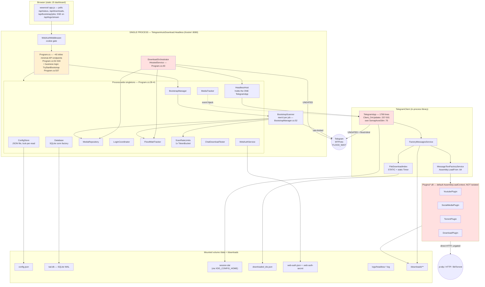
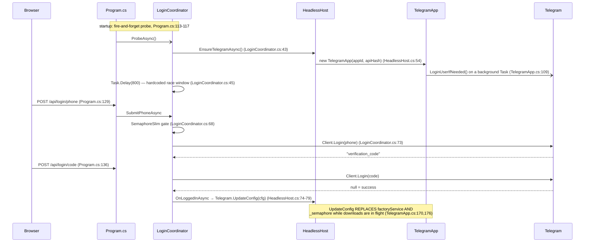
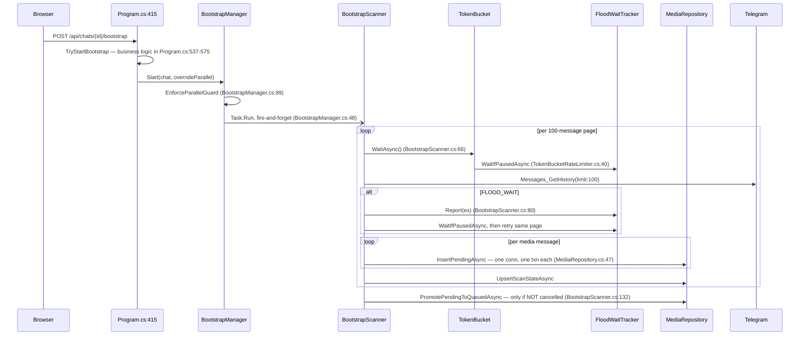
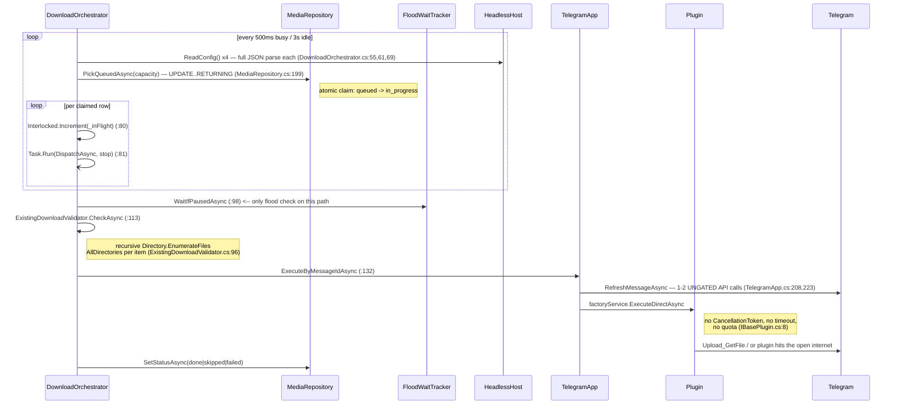
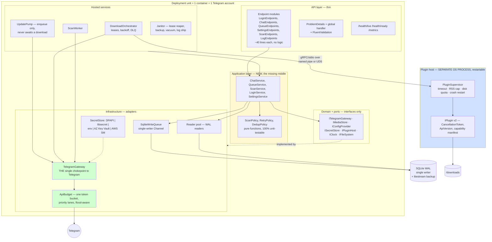
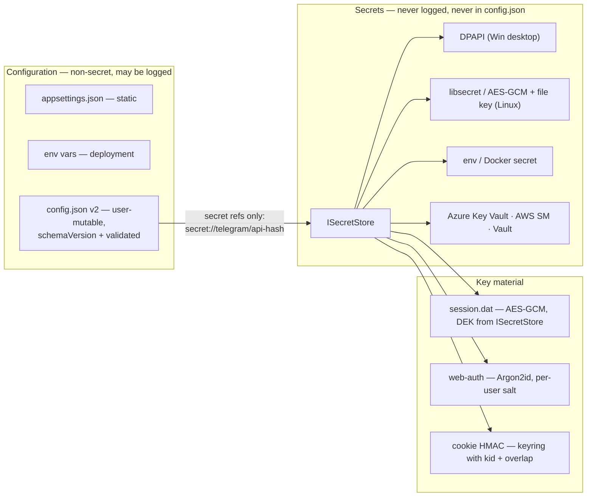

# TelegramAutoDownload — As-Is Assessment and Target Architecture

**Status:** Draft for review (Phase 2 re-run)
**Branch / commit:** `enterprise-readiness` @ `1c3753e`
**Reviewed:** 2026-10-01 — Composer 2.5 re-run
**Scope:** `TelegramAutoDownload.Headless` (server), `TelegramClient` (engine), `BasePlugin` + 4 plugin assemblies, `TelegramAutoDownload` (WPF desktop)
**Method:** Read-only static analysis of the working tree. No `dotnet build` or tests were run. Every factual claim about existing behaviour carries a `path:line` citation. Every number is either derived from code constants (shown) or explicitly labelled an estimate.

**Re-run outcome:** All prior Phase 2 conclusions stand after re-verification. No material code drift on the cited hot paths (`Program.cs` 641 lines, `TelegramApp.cs` 1799 lines, migration runner at `Database.cs:63-109`, token bucket wired only at `BootstrapScanner.cs:64-68`). One documentation correction: live-path DB writes advance via `OnComplete` (`Scanning/MediaTracker.cs:53-97`), not a separate `OnSaved` hook.

---

## 0. The scale assumption everything is calibrated against

Architecture advice is meaningless without a stated target. Everything below is calibrated against this, and I will reject proposals that only make sense above it.

| Dimension | p50 deployment | p99 deployment | Hard ceiling (why) |
|---|---|---|---|
| Telegram accounts per deployment | 1 | 1 | `session.dat` holds one auth key; `SessionLockHelper` exists precisely because two processes cannot share it (`TelegramClient/SessionLockHelper.cs:12`) |
| Monitored chats | 5–30 | 200 | `Messages_GetDialogs(limit: 500)` (`TelegramClient/TelegramApp.cs:742`) |
| Historical media rows after bootstrap | 50k | 2–5M | pagination at 100/page (`TelegramAutoDownload.Headless/Scanning/BootstrapScanner.cs:32`) |
| Stored media | 50–500 GB | 5–10 TB | disk, not software |
| New messages/day | < 2k | < 50k | |
| Sustained Telegram API budget | **~1 req/s** | **~5 req/s** | the product's own conservative default: `ScannerApiRefillPerSecond = 1.0`, burst 5 (`TelegramClient/Models/ConfigParams.cs:23-24`) |
| Concurrent file downloads | 3 | 10 | `DownloadThreads` default 3, clamped 1–10 (`ConfigParams.cs:18`, `Program.cs:195`) |
| "Enterprise" fleet | 1 deployment | 10–50 **independent** deployments | one account each |

**The load-bearing consequence:** this system's throughput is bounded by an external service's tolerance for request *rate*, not by our CPU, RAM, disk, or database. Every scaling proposal must be tested against the question *"does this let us make more Telegram calls safely?"*. If the answer is no, it is decoration.

---

## 1. As-Is architecture

### 1.1 Component diagram



Red = the three uncontrolled paths to Telegram. Amber = the layering violation.

### 1.2 Where state lives

| State | Location | Owner | Format | Durability story |
|---|---|---|---|---|
| App + per-chat config, **and `ApiHash` / `BotToken` in cleartext** | `/data/config.json` | `ConfigStore` (`ConfigStore.cs:17`) | JSON, full rewrite on every save (`ConfigStore.cs:41`) | none — no backup, no atomic temp+rename, no encryption |
| Media queue, scan watermarks, legacy dedup | `/data/tad.db` | `Database` / `MediaRepository` | SQLite WAL (`Database.cs:28,40`) | none — no backup, no `VACUUM`, no integrity check |
| Telegram auth key | `$XDG_CONFIG_HOME/TelegramAutoDownload/session.dat` | WTelegramClient, path **hardcoded** in `TelegramApp.cs:101-104` | binary | `HeadlessPaths.SessionFile` (`HeadlessPaths.cs:22`) is declared but **never referenced anywhere** — the container only works because `Dockerfile:46` sets `XDG_CONFIG_HOME=/data` |
| Dedup index (second copy) | `/data/TelegramAutoDownload/downloaded_ids.json` | `FileDownloadIndex` — static class, static `Timer` (`FileDownloadIndex.cs:23-35`) | JSON array, **full rewrite every 10 s** | temp+rename (`FileDownloadIndex.cs:115-118`) |
| Dashboard credentials | `/data/web-auth.json` + `/data/.web-auth-secret` | `WebAuthService` | unsalted SHA-256 (`WebAuthService.cs:248`) + base64 HMAC key in plaintext (`WebAuthService.cs:243`) | none |
| Live download progress | **process memory only** | `HeadlessHost._downloads` (`HeadlessHost.cs:33`) | `ConcurrentDictionary`, trimmed at 60 s (`HeadlessHost.cs:140-146`) | lost on restart |
| Bootstrap job status | **process memory only** | `BootstrapManager._running` (`BootstrapManager.cs:20`), dropped after 5 min (`BootstrapManager.cs:69`) | | lost on restart |
| Logs | `/data/logs/headless-*.log`, 7-day retention | Serilog (`Program.cs:18-22`) | text | rolled, not shipped |

### 1.3 Request and data flows

#### Login



Defects visible in this flow: an 800 ms `Task.Delay` substituting for a readiness signal (`LoginCoordinator.cs:45`); login state held only in fields on a singleton with no persistence; `Stage` is mutated from a background probe *and* from HTTP handlers, and only the HTTP path is gated by `_gate` — `ProbeAsync` writes `Stage` outside the semaphore (`LoginCoordinator.cs:46`).

#### Chat refresh

`POST /api/chats/refresh` (`Program.cs:251`) → `HeadlessHost.RefreshChatsAsync` (`HeadlessHost.cs:154`) → `Telegram.GetAllChats()` (`TelegramApp.cs:1560`) → merge saved per-chat settings field-by-field, 20 hand-copied assignments (`HeadlessHost.cs:169-189`) → `_config.Save(cfg)` full-file rewrite → `Telegram.UpdateConfig(cfg)`, which **reconstructs `factoryService` and replaces `_semaphore`** (`TelegramApp.cs:170,176`).

Two problems. First, the merge is a manual field list: any new `ChatDto` property is silently dropped on refresh unless someone remembers to add a line — a latent data-loss bug with no test guarding it. Second, refreshing the chat list is a *read* operation from the user's perspective, but it tears down and rebuilds the download pipeline mid-flight.

#### Bootstrap scan



#### Download execution



#### Live status polling

`GET /api/status` (`Program.cs:519`) reads config from disk, counts selected chats, and calls `host.SnapshotDownloads()` which **materialises, sorts and takes 200 entries out of a `ConcurrentDictionary` on every request** (`HeadlessHost.cs:150-151`) — and `/api/status` calls it again for the active count (`Program.cs:530`). `GET /api/downloads` does the same. The dashboard polls both. There is no ETag, no cache, no push except for logs.

`GET /api/logs/stream` is an SSE loop with a hardcoded 1 s `Task.Delay` re-reading the file from a byte offset (`Program.cs:341-354`); every connected browser tab holds a request thread doing file I/O.

### 1.4 Threading and concurrency model

There are **five independent schedulers** touching one Telegram account, and they do not know about each other.

| # | Path | Gate | Size | Flood-aware? | Token-bucket? | Evidence |
|---|---|---|---|---|---|---|
| 1 | Bootstrap page fetch | `ScanRateLimits.TelegramApi` | 1 shared bucket, cap 5, refill 1/s | **yes** | **yes** | `ScanRateLimits.cs:13-19`, `BootstrapScanner.cs:66` |
| 2 | Bootstrap job fan-out | `BootstrapManager._running` | `MaxParallelBootstraps` 1–10 | via #1 | via #1 | `BootstrapManager.cs:111` |
| 3 | Orchestrator download | `_inFlight` vs `DownloadThreads` | 1–10 | yes (at dispatch only) | **no** | `DownloadOrchestrator.cs:30,61,98` |
| 4 | Live update download | `TelegramApp._semaphore` | 1–10, **separate instance** | **no** | **no** | `TelegramApp.cs:70,176,349` |
| 5 | Ad-hoc API calls (`GetAllChats`, `ResolveInputPeerAsync`, `ChatDownloadTester`, `SyncHistoryAsync`) | none | unbounded | **no** | **no** | `TelegramApp.cs:742`, `Program.cs:255,430` |

`TelegramClient` contains **no reference to `FloodWaitTracker`** — the type exists only in the Headless assembly, and grep over `*.cs` confirms `TelegramClient` only references the stateless `FloodWaitHelper` parser. Paths 4 and 5 are therefore structurally incapable of honouring a flood pause.

---

## 2. Architectural defects

### D-1 — Three uncoordinated concurrency governors against one rate-limited account (**critical**)

The token bucket is described in its own doc comment as gating "outbound Telegram API calls" (`TokenBucketRateLimiter.cs:10`), but it is wired into exactly one call site: `BootstrapScanner.cs:66`. `ScanRateLimits` exposes only `TelegramApi` (`ScanRateLimits.cs:9`) and the promised `DownloadLimiter` from the same comment (`TokenBucketRateLimiter.cs:11-12`) was never built.

Worst-case simultaneous in-flight Telegram operations, all against one account:

```
  10  orchestrator downloads      (DownloadThreads max, Program.cs:195)
+ 10  live-update downloads       (_semaphore, TelegramApp.cs:176 — independent instance)
+ 10  bootstrap scanners          (MaxParallelBootstraps cap, Program.cs:239)
+  n  ungated ad-hoc calls        (GetAllChats, ResolveInputPeerAsync, test-download)
= 30+ concurrent, of which only the bootstrap slice consumes tokens
```

Both #3 and #4 are sized from the *same* `DownloadThreads` value, so a user who sets "3 download threads" in the UI actually authorises six concurrent downloads. This is the defect most likely to produce the outcome the product exists to prevent: a banned account.

### D-2 — The live-update path is flood-blind and blocks the update pump (**critical**)

`Client_OnUpdates` ends with `await Task.WhenAll(tasks)` (`TelegramApp.cs:495`), where each task performs a full download including plugin execution (`TelegramApp.cs:405`). WTelegramClient's update dispatch therefore cannot return until every download in the batch completes. Since plugins have no timeout (§D-5), a single hung yt-dlp invocation stalls update processing indefinitely.

The failure mode compounds: stalled updates → Telegram sends `UpdateChannelTooLong` → the handler fires `ProcessMissedMessagesAsync` (`TelegramApp.cs:283`) → catch-up history fetches, ungated and flood-blind → FLOOD_WAIT → more stalling. A positive feedback loop terminating in an account restriction.

### D-3 — Two dedup authorities that permanently diverge (**critical, silent data corruption**)

- Authority A: `FileDownloadIndex`, a static class with a static `Timer` writing the entire ID set to `downloaded_ids.json` every 10 s (`FileDownloadIndex.cs:23-35, 109-121`).
- Authority B: SQLite, via `MediaRepository.IsKnownDocumentAsync`, which unions `Media WHERE status='done'` with `LegacyDedup` (`MediaRepository.cs:28-37`).

`LegacyDedupMigration.RunAsync` imports the JSON into `LegacyDedup` **exactly once, ever** — it early-returns whenever the table is non-empty (`LegacyDedupMigration.cs:17-22`). Meanwhile `FileDownloadIndex` keeps appending to that same JSON file for the life of the deployment. From the second startup onward the two stores diverge monotonically. `ExistingDownloadValidator` consults only B (`ExistingDownloadValidator.cs:37-38`); the download pipeline consults only A. Result: duplicate downloads and false skips, both silent.

Secondary: the JSON rewrite is O(n). At the p99 scale of 2M downloaded documents that is roughly a 20 MB serialize-and-write **every 10 seconds** (estimate: ~10 bytes per decimal ID plus separators).

### D-4 — No layering, no seams, and zero test coverage of the server (**critical for velocity**)

- All ~40 endpoints are inline lambdas in `Program.cs` lines 52–533, interleaved with startup side-effects at lines 105–117.
- Business logic lives there too: `TryStartBootstrap` performs config lookup, login checks, monitoring policy and conflict-to-HTTP mapping (`Program.cs:537-575`).
- Endpoints reach past the domain straight into persistence: `/api/queue/retry-failed` calls `repo.RequeueAllFailedAsync` directly (`Program.cs:465`), as do `/retry-skipped`, `/delete-failed`, `/clear` (`Program.cs:471,477,484`).
- The entire solution declares **four** interfaces — `IBasePlugin`, `IConfigTelegramLogger`, `IConfigLogger`, `IChannel`. None abstracts Telegram, storage, the filesystem, or the clock. Every concrete type is `sealed` and newed directly (`BootstrapManager.cs:52` news a `BootstrapScanner`; `HeadlessHost.cs:54` news a `TelegramApp`).
- `TelegramAutoDownload.Tests.csproj` references seven projects (lines 21-29) and **`TelegramAutoDownload.Headless` is not among them**. It also targets `net8.0-windows` (line 4), so it cannot run on the Linux CI that would build the container. The 296 existing test cases cover zero lines of the orchestrator, repository, rate limiter, flood tracker, scanner, or any endpoint.

### D-5 — Plugins are unversioned, unsandboxed, uncancellable and unquota'd (**critical**)

`IBasePlugin` is four members and carries no version, no capability declaration and — decisively — **no `CancellationToken`** (`BasePlugin/IBasePlugin.cs:3-9`). Consequences:

- **Hang** → the plugin holds an orchestrator `_inFlight` slot forever (`DownloadOrchestrator.cs:80` increments, `:188` decrements in a `finally` that never runs) or a `_semaphore` slot (`TelegramApp.cs:349`). Capacity degrades permanently until restart. There is no timeout anywhere in the chain.
- **Crash** → assemblies are `Assembly.LoadFrom`'d into the default `AssemblyLoadContext` (`MessageTextFactoryService.cs:64`), so a `StackOverflowException`, `Environment.Exit`, or unhandled background-thread exception takes down the dashboard, the orchestrator and the Telegram session together.
- **Disk** → `Config` hands the plugin `PathSaveFile` (`MessageTextFactoryService.cs:124`) with no quota, no free-space precondition and no post-write accounting. `TorrentPlugin` in particular can write unbounded data.
- **Versioning** → no ABI gate. A plugin built against an older `BasePlugins.dll` either fails at `GetTypes()` and is silently swallowed (`MessageTextFactoryService.cs:72-75`) or half-loads.
- **Lifecycle** → a fresh instance is reflected into existence per URL line per message (`MessageTextFactoryService.cs:112-117`), so there is nowhere to hold a connection pool or a rate limiter.

### D-6 — Concurrency hazards in the scanner/orchestrator/tracker interaction (**high**)

1. **`_inFlight` leak.** `Task.Run(() => DispatchAsync(row, stop), stop)` (`DownloadOrchestrator.cs:81`) is preceded by `Interlocked.Increment` at `:80`. If `stop` is already signalled, `Task.Run` returns a cancelled task **without invoking the delegate**, so the `finally` at `:187-189` never decrements. The row also stays `in_progress`. Recovered only by the startup sweep at `Database.cs:56-58`.
2. **Infinite poison loop.** The FLOOD_WAIT handler resets the row to `Queued` (`DownloadOrchestrator.cs:171`) — a status that does **not** bump `attempts` (`MediaRepository.cs:79` increments only on `Failed`). `PickQueuedAsync` orders by `queued_at ASC` (`MediaRepository.cs:213`), and nothing anywhere reads `attempts` to cap retries or apply backoff. A row that reliably triggers FLOOD_WAIT will be retried forever, at the front of the queue.
3. **MediaTracker write-ordering race.** `OnMessageDiscovered` fires the insert as fire-and-forget (`Scanning/MediaTracker.cs:69`), and `OnStarted` fires the status update as fire-and-forget (`Scanning/MediaTracker.cs:43-46`). Nothing orders them. When `OnStarted` wins, the `UPDATE` matches zero rows and the state transition is lost silently.
4. **MediaTracker keys on display name.** `_chatIdByName` maps chat *name* → id (`MediaTracker.cs:28,62`). Two chats with the same display name collide and rows are attributed to the wrong chat. Neither `_chatIdByName` nor `_lastMsgIdByChatFile` is ever bounded; `_lastMsgIdByChatFile` only erases on a successful `OnComplete` (`MediaTracker.cs:97`), so every skip, filter-drop or failure leaks an entry for process lifetime.
5. **`UpdateConfig` mutates live state.** It replaces `factoryService` and `_semaphore` (`TelegramApp.cs:170,176`) while downloads are running. The semaphore swap is defended by capturing the instance (`TelegramApp.cs:346`, good), but the `factoryService` swap is not: `ExecuteByMessageIdAsync` null-checks at `:711` then dereferences at `:714`, and any `PATCH /api/chats/{id}` (`Program.cs:261`) can null-and-replace it in between.
6. **`Cache=Shared` with WAL.** The connection string sets `Cache=Shared` (`Database.cs:28`) while every operation opens a *new* connection (`MediaRepository` calls `_db.Open()` in all 25 methods). Shared-cache mode introduces table-level locks that surface as `SQLITE_LOCKED`, which — unlike `SQLITE_BUSY` — is **not** retried by `busy_timeout = 5000` (`Database.cs:43`). This is a latent hard-failure under concurrency, and it is unnecessary.
7. **PRAGMA on every open.** `Database.Open()` executes four PRAGMAs per connection (`Database.cs:39-44`), including `journal_mode = WAL`, which writes the database header. This is done on the order of 100+ times per second under bootstrap load.
8. **Token bucket fairness.** Waiters in `TokenBucketRateLimiter.WaitAsync` sleep independently outside the lock (`TokenBucketRateLimiter.cs:59`) and race on wake. With `MaxParallelBootstraps` waiters there is no FIFO guarantee; one scanner can starve.

### D-7 — Error-handling gaps (**high**)

- **Silent catch-all swallowing.** `catch { }` with no logging at `TelegramApp.cs:147, 158, 149, 376, 379, 397`; `catch { /* next poll */ }` around the status write that records *why* a download failed (`DownloadOrchestrator.cs:174, 184`) — so the one fact the operator needs can be dropped without trace.
- **No global exception handler.** `Program.cs` has no `UseExceptionHandler`, no `ProblemDetails`, and no `UseStatusCodePages`. Unhandled exceptions in any endpoint return a bare 500 with a stack trace in Development.
- **Inconsistent error shape.** Endpoints variously return `{ error }` (`Program.cs:74`), `{ error, conflict, canOverride, blockingChat, blockingChatId }` (`Program.cs:554-560`), and a bare `499` (`Program.cs:435`). No client can handle these uniformly.
- **`ProbeAsync` failure is fire-and-forget.** `_ = Task.Run(...)` at `Program.cs:113` with only a `Log.Warning`. If credentials are missing the app starts "healthy" and silently never downloads.
- **No input validation framework.** Clamping is scattered inline (`Program.cs:195, 232-239, 400`) with no shared validator and no 422 responses.
- **No health endpoint.** `docker-compose.yml` has no `healthcheck`; nothing distinguishes "process up" from "logged in and draining the queue".

### D-8 — Secrets and configuration are not enterprise-grade (**high**)

- `ApiHash` and `BotToken` are plain properties on `ConfigParams` (`ConfigParams.cs:12,15`), serialised in cleartext to `/data/config.json` (`ConfigStore.cs:41`), and returned wholesale from `ReadConfig()` to any caller including endpoints.
- `docker-compose.yml:17` ships `WEB_PASSWORD: "changeme"` **committed to version control**, matching the `DefaultPassword` constant (`WebAuthService.cs:16`).
- Dashboard passwords are **unsalted, un-stretched SHA-256** (`WebAuthService.cs:248-249`) — offline-crackable at billions of guesses per second.
- The cookie HMAC key is written base64 to `/data/.web-auth-secret` in plaintext (`WebAuthService.cs:243`), with no rotation path: rotating it invalidates all sessions with no grace window, and there is no key-id in the cookie (`WebAuthService.cs:136`).
- `Secure` on the session cookie is **opt-in** via env var and defaults to `false` (`WebAuthService.cs:141`).
- `session.dat` — a live Telegram auth key granting full account access — sits unencrypted on the volume.
- No config schema, no validation-on-load, no versioning: `ConfigStore.Read()` deserializes and patches two fields (`ConfigStore.cs:30-34`) and accepts anything else.

### D-9 — God objects (**medium-high, velocity tax**)

`TelegramClient/TelegramApp.cs` is 1,799 lines and holds at least nine responsibilities: session lifecycle (`:99-159`), config application (`:166`), the update pump (`:257-501`), history sync (`:507`), orchestrator dispatch (`:709`), peer resolution (`:731`), chat browsing (`:824`), member export (`:966`), history export (`:1089`), reactions (`:1435-1558`), and dialog enumeration (`:1560-1741`). `Client_OnUpdates` alone is 245 lines with nesting depth 9 and eight distinct `catch` blocks. `MainWindow.xaml.cs` is 1,478 lines and `Program.cs` is 641.

*Correction to the brief:* there is no quiet-hours implementation in the codebase — a case-insensitive search for `quiet` across all `*.cs` returns zero matches.

### D-10 — Throughput ceilings nobody measured (**medium**)

- `ExistingDownloadValidator.FindOnDisk` runs `Directory.EnumerateFiles(chatDirectory, fileName, SearchOption.AllDirectories)` **per queued item** (`ExistingDownloadValidator.cs:96`), on the hot path at `DownloadOrchestrator.cs:113`. At the p99 scale of a chat folder holding 100k files this is a full recursive walk per download.
- **Config read amplification.** `ConfigStore.Read()` does `File.ReadAllText` + full Newtonsoft deserialize **every call** (`ConfigStore.cs:29-30`), with no caching. The orchestrator loop calls it four times per iteration (`DownloadOrchestrator.cs:55,61,69`) at up to 2 Hz, and `ScanRateLimits` calls it on **every token acquire and every retry spin** (`ScanRateLimits.cs:15`, invoked from `TokenBucketRateLimiter.cs:47` inside a loop with a 50 ms floor at `:59`). At the p99 scale of 200 chats the config JSON is hundreds of kilobytes. Estimated: 10–30 full parses per second at idle.
- `SnapshotDownloads()` allocates, sorts and takes 200 on every poll (`HeadlessHost.cs:150`), called twice per `/api/status` request cycle.
- `UpsertByName` does a **linear scan with `EndsWith` over the whole dictionary** on every progress callback (`HeadlessHost.cs:122-125`), and then sweeps the dictionary for expired entries (`HeadlessHost.cs:141-145`) — on every progress tick of every download.

### D-11 — Migration framework is real but not production-grade (**medium**)

*Correction to the brief:* a migration runner does exist — `Database.ApplyMigrationsAsync` (`Database.cs:63-109`) discovers embedded `*.sql` resources, orders them lexically, applies each inside a transaction and records it in `SchemaMigration`. That is a sound foundation. What it lacks: no checksum (an edited applied script is silently ignored), no baseline/stamp for an existing database, no down-migrations, no dry-run or `--verify` mode, no advisory lock so two starting processes cannot race, ordering by *resource name* rather than parsed version (so `10_x.sql` sorts before `2_x.sql`), and unparseable filenames are merely warned about and skipped (`Database.cs:89`).

There is also **no migration story at all for the non-SQL state** that the brief calls out: `config.txt` (WPF, `TelegramAutoDownload/AppPaths.cs:17`) → `config.json` (headless), `stats.json` (`AppPaths.cs:22`) → nothing, `session.dat` → hardcoded path, `downloaded_ids.json` → the one-shot import in D-3.

---

## 3. Target architecture

### 3.1 Guiding principle

> **One Telegram account is one bulkhead.** Every capacity decision derives from a single per-account request budget; every isolation decision derives from the blast radius of losing that account.

### 3.2 Target component diagram



### 3.3 (a) Multi-tenancy — **remain single-tenant per deployment**

See **ADR-001**. Summary of the reasoning, with evidence:

1. **The tenancy unit is a Telegram account, and the runtime cannot hold two.** `session.dat` is exclusively locked — `SessionLockHelper` exists solely to retry that lock for up to 40 seconds (`SessionLockHelper.cs:32-33`), and the path is a hardcoded process-global constant (`TelegramApp.cs:101-104`, `:161-164`). Every singleton in `Program.cs:28-41` is bound to that one session.
2. **Co-tenancy converts single-tenant faults into fleet outages.** Plugins execute in-process with no isolation (`MessageTextFactoryService.cs:64`) and no timeout (`IBasePlugin.cs:8`). One tenant's malicious or buggy plugin would take down every co-located tenant's session, and re-establishing a Telegram session requires an **interactive SMS code** — so recovery is not automatic. Blast radius: N tenants × manual re-auth.
3. **The schema has no tenant dimension and `chat_id` is not globally unique.** `Media`'s primary key is `(chat_id, message_id)` (`Data/Schema/001_initial.sql:32`); `ChatScanState` and `LegacyDedup` key on `chat_id` and `document_id` alone (`:43, :55`). Two accounts that share a public channel collide. Retrofitting `tenant_id` touches all 25 repository methods, all three tables, every index, and every endpoint — and the data is a person's entire private message archive, where a scoping bug is a reportable breach rather than a bug.
4. **The economics do not justify it.** At the stated 10–50 deployment fleet, a container is roughly 200 MB idle. Fifty containers is ~10 GB of RAM — a single commodity host. ADR-001 costs the multi-tenant rewrite at **22 engineer-weeks** against the ~2 engineer-weeks of a thin fleet control plane.

**What we build instead:** a per-deployment container with a documented `tenant-id` label, and (optionally, Milestone E) a thin control plane that renders compose/Helm manifests, aggregates `/health` and `/metrics`, and centralises log shipping. It never touches tenant data.

**The trigger that would reverse this decision** (stated so it is falsifiable): if we ever need **> 200 concurrent tenants** *or* Telegram ships an official multi-account business API where sessions are server-side tokens rather than local key material, revisit ADR-001.

### 3.4 (b) Horizontal scale under the FLOOD_WAIT ceiling

**Horizontal scale of Telegram access is impossible and must be explicitly rejected.** Adding a second process cannot add a second account, and a second process cannot share `session.dat`. What *can* scale is (i) allocating the fixed budget intelligently and (ii) moving non-Telegram work off the critical path.

**Design: one `ApiBudget` with priority lanes** (ADR-003). Every Telegram call in the system routes through `ITelegramGateway`, which acquires from a single token bucket before issuing. Lanes, highest priority first:

| Lane | Workload | Reserved share | Rationale |
|---|---|---|---|
| `Interactive` | login, chat refresh, test-download | 20 %, burst-favoured | a human is waiting; volume is negligible |
| `Live` | update-pump metadata + new-message downloads | 50 % | freshness is the product |
| `Backfill` | bootstrap pages, catch-up, orchestrator re-fetch | 30 %, yields under pressure | unbounded volume, no deadline |

Budget derivation from the code's own constants: the shipped safe default is **1 request/s sustained, burst 5** (`ConfigParams.cs:23-24`). One bootstrap page is 100 messages (`BootstrapScanner.cs:32`), so at the default rate discovery runs at **100 messages/s ≈ 360k messages/hour** — a 1M-message channel bootstraps in ~2.8 hours. The download path needs 1–2 metadata calls per item (`TelegramApp.cs:208,223`); at 10 concurrent downloads averaging 30 s each that is **0.33 items/s ≈ 0.67 req/s**. Live traffic at the p99 of 50k messages/day is **0.58 req/s** average. Total sustained demand ≈ **1.3 req/s** against a 1 req/s default budget — meaning the *correct* fix is not more workers, it is (a) a shared budget so the lanes negotiate, and (b) raising the ceiling empirically with an adaptive controller.

**Adaptive budget.** `FloodWaitTracker` currently only pauses (`FloodWaitTracker.cs:54-65`) and never adjusts the rate, so the system re-enters the same over-rate state after every pause. Replace with AIMD: additive increase of +0.1 req/s per 10 flood-free minutes up to the configured max; multiplicative decrease to 50 % on every FLOOD_WAIT, floored at 0.2 req/s. This turns the flood signal into control input instead of a speed bump.

**Where real parallelism does help** (and is safe, because it touches no Telegram API):

| Work | Today | Target | Ceiling |
|---|---|---|---|
| Byte transfer | inside the API-call gate | separate `TransferPool`, sized by NIC/disk not by API budget | ~10–20 MB/s per account *(estimate — no published Telegram figure; community-observed)* |
| Plugin execution (yt-dlp, torrent) | in-process, in the download slot | separate process pool, sized by CPU | CPU / upstream site limits |
| Dedup + preflight | recursive disk walk per item (`ExistingDownloadValidator.cs:96`) | indexed DB lookup | O(log n) |
| DB writes | 25 ad-hoc connections | one writer channel, batched | ~1–2k commits/s |

**Migration path.** Add `ITelegramGateway` in `TelegramClient` with a single implementation wrapping the existing `Client`. Mechanically route the four ungated call sites through it: `TelegramApp.cs:208, 223, 742` and `BootstrapScanner.cs:73`. Move `FloodWaitTracker` and `TokenBucketRateLimiter` from `TelegramAutoDownload.Headless/Scanning/` down into `TelegramClient` so the engine can see them — today it structurally cannot. Delete `TelegramApp._semaphore` (`:70`) and let the gateway be the only gate. **Effort: 3 engineer-weeks.**

### 3.5 (c) Durable queue and effectively-once download semantics

**Exactly-once is not achievable** — the process can die between the byte-write on disk and the `SetStatusAsync('done')` commit (`DownloadOrchestrator.cs:148`), and there is no distributed transaction across the filesystem and SQLite. The honest target is **at-least-once delivery with idempotent, content-addressed completion**, which is observationally effectively-once. ADR-005.

What exists and is good: `PickQueuedAsync` is a genuinely atomic claim via `UPDATE … WHERE rowid IN (SELECT …) RETURNING *` (`MediaRepository.cs:206-230`), and startup crash recovery resets stuck rows (`Database.cs:56-58`).

What is missing:

| Gap | Evidence | Fix |
|---|---|---|
| No lease — a claim is held forever by a dead or hung worker | `in_progress` has `started_at` (`001_initial.sql:29`) but nothing reads it | add `lease_until`, `lease_owner`; Janitor reclaims expired leases every 30 s (recovery in seconds, not "next restart") |
| No attempt cap | `attempts` incremented only on `Failed` (`MediaRepository.cs:79`); never read anywhere | cap at 5, then → `dead` |
| No backoff | `ORDER BY queued_at ASC` (`:213`) puts the just-failed row first | add `next_attempt_at`; `WHERE next_attempt_at <= now`; exponential with jitter |
| FLOOD_WAIT retries are uncounted | resets to `Queued`, which skips the increment (`DownloadOrchestrator.cs:171`) | distinguish `attempts` from `flood_deferrals`; cap the latter separately |
| No dead-letter queue | `failed` is terminal-ish but re-queueable en masse (`Program.cs:465`) | `dead` status + `/api/queue/dead` + explicit revive |
| Completion is not idempotent | `SetDownloadedPathAsync` after the fact (`DownloadOrchestrator.cs:150`) | write to `{final}.part`, `fsync`, atomic rename, *then* commit — the pattern `FileDownloadIndex.cs:115-118` already uses correctly; reuse it |
| Live path bypasses the queue entirely | `MediaTracker` drives `pending → in_progress → done` outside the orchestrator (`DownloadOrchestrator.cs:16-19` documents this) | unify: the update pump **only enqueues**; the orchestrator is the sole executor |

Unifying the two paths (last row) is the single highest-value change here. It deletes the `MediaTracker` event-hijacking design (`MediaTracker.cs:39-58`) and with it defects D-6.3 and D-6.4, removes the second concurrency governor from D-1, and removes the inline `await Task.WhenAll` from D-2 — four defects retired by one structural change.

**Migration path.** Migration `002_queue_leases.sql` adds five nullable columns (additive, no rewrite, safe to roll forward on a live DB). Ship the Janitor and the lease-aware `PickQueuedAsync` behind a config flag; run both paths for one release with a metric comparing claim counts; then flip the update pump to enqueue-only. **Effort: 2.5 engineer-weeks.**

### 3.6 (d) API process vs worker process — **keep them together, split out plugins instead**

ADR-004. The usual reason to split API from worker is independent scaling; that reason does not apply, because the worker cannot be scaled past one (§3.4). The remaining reason is fault isolation — and the actual fault source is not the orchestrator, it is plugin code.

Arguments against an API/worker split, from the code:

- Three endpoint families require the live Telegram session in the request path: login (`Program.cs:131,138,145`), chat refresh (`Program.cs:255`), and test-download (`Program.cs:430`). Splitting forces an IPC contract for all three, including a streaming one for the interactive login state machine.
- Every singleton is shared between both roles (`Program.cs:28-41`). `HeadlessHost` is simultaneously the session holder, the config applier and the live-progress cache read by `/api/downloads` (`HeadlessHost.cs:150`).
- The split buys no availability: if the worker dies the session dies, and the API can then serve only stale rows.

Arguments for splitting out the **plugin host**, from the code: plugins are the only untrusted, unbounded, third-party-dependency-laden code in the system (`MessageTextFactoryService.cs:64`; `IBasePlugin.cs:8`), and they shell out to `yt-dlp` and run a BitTorrent stack. Moving them out of process is where the isolation money is.

**Decision: two processes — `tad-server` (API + engine + orchestrator) and `tad-pluginhost` (supervised, restartable, resource-capped).** A `[SupervisedProcess]` boundary, not a microservice: no service discovery, no network, no schema registry. Transport is a Unix domain socket / named pipe, framed protobuf.

**Migration path.** `IPluginHost` port with two adapters: `InProcessPluginHost` (today's behaviour, default) and `OutOfProcessPluginHost`. Ship both, default off, flip after a release of telemetry. **Effort: 4 engineer-weeks** (counted in §3.8).

### 3.7 (e) Storage — **keep SQLite**, with an enforced single-writer boundary

ADR-002. This is the decision the brief asks to be justified with derived numbers, so here is the derivation.

**Required write rate, from code constants.**

*Bootstrap (the heaviest writer).* Default 1 page/s (`ConfigParams.cs:24`) × ≤100 media rows/page (`BootstrapScanner.cs:32`) = ≤100 `INSERT OR IGNORE` (`MediaRepository.cs:47`) + 1 `UpsertScanStateAsync` (`BootstrapScanner.cs:112`) → **≈ 101 writes/s peak**. With `MaxParallelBootstraps = 3` (`ConfigParams.cs:34`) sharing one bucket, the aggregate is unchanged — the bucket, not the job count, sets the rate.

*Downloads.* 4 writes per item (claim, preflight status, terminal status, path) × 0.33 items/s at 10 concurrent × 30 s average → **≈ 1.3 writes/s**.

*Live path.* ~3 writes/message; at the p99 of 50k messages/day → **≈ 1.7 writes/s** average.

*Sustained total:* **< 10 writes/s.** *Peak during bootstrap:* **≈ 101 writes/s.** The UI does allow 50 pages/s (`Program.cs:233`) → 5,000 writes/s, but that setting already exceeds the safe Telegram budget by ~50×, so it is not a real operating point — and ADR-003's budget removes it as one.

**Available write rate.** SQLite in WAL with `synchronous = NORMAL` (`Database.cs:40-41`) sustains roughly **1,000–10,000 single-statement commits/s** on SSD. This deployment pays per-call overhead — a fresh `SqliteConnection` plus four PRAGMAs for every operation (`Database.cs:35-46`) — which I estimate cuts the effective ceiling to **~1,000–2,000 commits/s**. *(Estimate: not measured; a benchmark is the first task of Milestone A.)*

> ### The deciding number
> **Peak demand ≈ 101 writes/s against an effective SQLite ceiling of ~1,000–2,000 writes/s — roughly 10–20× headroom at peak and ~100× at steady state — with a hard requirement of exactly one writer *process*, because the Telegram session cannot be shared (`SessionLockHelper.cs:12-23`).**
>
> Postgres's decisive advantage is concurrent multi-process writes. That advantage is **structurally unusable here**. Adopting it would add an operational dependency (HA, backups, connection pooling, version upgrades, a second container) to every one of the 10–50 single-account deployments in exchange for capacity we cannot consume. **Verdict: SQLite.**

**But the current SQLite usage is wrong in three fixable ways:**

1. **Remove `Cache=Shared`** (`Database.cs:28`). It is the default-off setting for a reason: with WAL and many connections it introduces table-level locks that surface as `SQLITE_LOCKED`, which `busy_timeout` (`Database.cs:43`) does not retry. This is a latent hard failure and the fix is deleting nine characters.
2. **Enforce one writer.** Today all 25 `MediaRepository` methods open their own connection and write. Introduce `SqliteWriteQueue`: a `System.Threading.Channels` serialiser owning **one** long-lived write connection, with reads going to a separate pooled read-only connection set. This makes the single-writer invariant a compile-time property rather than a hope, enables safe batching of bootstrap inserts (100 rows → 1 transaction, a ~100× reduction in commits), and removes the per-call PRAGMA cost.
3. **Add durability.** Continuous WAL replication (Litestream sidecar or equivalent) to object storage, a nightly `VACUUM INTO` snapshot, and a startup `PRAGMA integrity_check`. Today there is **no backup of anything**.

**Migration path.** Zero schema change. Change the connection string, introduce `IMediaStore` over the existing `MediaRepository` surface, move writes behind the channel method-by-method (the 25 methods are independent; this is incremental and each step is individually shippable), add the backup sidecar to compose. **Effort: 1.5 engineer-weeks.**

### 3.8 (f) A real migration framework

ADR-007. Keep the existing embedded-SQL runner (`Database.cs:63-109`) — it is a correct design — and close its six gaps:

| Gap | Evidence | Fix |
|---|---|---|
| No checksum | only `version` is stored (`Database.cs:66-70`) | add `checksum` column; fail startup on drift |
| Lexical ordering | `.OrderBy(n => n)` on the resource name (`Database.cs:79`) — `010` before `2` | parse to `long` first (already parsed at `:86`), order numerically |
| Unparseable scripts skipped | `Log.Warning` + `continue` (`Database.cs:89`) | fail fast |
| No concurrency guard | two starting processes race | `BEGIN IMMEDIATE` advisory lock around the whole run |
| No baseline | an existing DB cannot be stamped | `--baseline <version>` CLI |
| No dry-run / no down | | `migrate --verify`, `--plan`; paired `NNN_name.down.sql`, tested in CI |

**Application-state migration is the bigger gap** and needs its own versioned pipeline, because the brief's constraint is real: there are installed desktop users.

| Artifact | From | To | Strategy |
|---|---|---|---|
| `config.txt` (`AppPaths.cs:17`) | WPF `ConfigFile` | `config.json` v2 with a `schemaVersion` field | forward-only `IConfigMigration` chain, run on load, backup-before-write |
| `downloaded_ids.json` | `FileDownloadIndex` | `LegacyDedup` table | **continuous reconciliation, not one-shot** — removes D-3; see ADR-010 |
| `stats.json` (`AppPaths.cs:22`) | `StatisticsService` | `Stats` table | one-shot import, guarded by checksum not row-count |
| `session.dat` | hardcoded `%APPDATA%` (`TelegramApp.cs:101`) | `ISecretStore`-wrapped, path injected | copy-on-first-run, keep the old file for one release |
| `tad.db` | — | — | schema migrations above |

Every step: back up first, record `{from, to, timestamp, checksum}` in a `MigrationLog` table, and expose `GET /api/system/migrations`. If a migration cannot run, **refuse to start** with an actionable message rather than silently degrading — the current behaviour for a corrupt dedup index is `catch { }` and continue with an empty set (`FileDownloadIndex.cs:105`), which silently re-downloads the user's entire archive.

**Breaking-change gate.** Desktop ≥ the version that writes `schemaVersion` can round-trip. Anything older is read-only-import: the app imports, writes a new file, and keeps the original as `config.txt.pre-v2.bak`. **Effort: 2 engineer-weeks** (framework) + 1 engineer-week (config/state migrations, in Milestone D).

### 3.9 (g) Versioned, sandboxable plugin contract

ADR-006. Contract v2, with v1 supported for one release via a shim.

```csharp
// Versioned, cancellable, capability-declaring. Shipped in BasePlugins v2.
public interface IPlugin
{
    static abstract PluginManifest Manifest { get; }   // Name, SemVer, ApiVersion, Capabilities, Limits
    bool CanHandle(PluginRequest request);
    Task<PluginResult> ExecuteAsync(PluginRequest request, IPluginContext ctx, CancellationToken ct);
}

public sealed record PluginManifest(
    string Name, Version Version,
    int    ApiVersion,                 // host refuses to load on mismatch
    PluginCapabilities Capabilities,   // Network | Subprocess | WriteDownloads | ReadConfig
    ResourceLimits Limits);            // MaxRuntime, MaxBytesWritten, MaxMemoryMb

public sealed record ResourceLimits(
    TimeSpan MaxRuntime, long MaxBytesWritten, int MaxMemoryMb);
```

`IPluginContext` replaces today's raw `PathSaveFile` string (`MessageTextFactoryService.cs:124`) with a quota-enforcing writer, a progress reporter, and a scoped logger. The plugin never receives a filesystem root.

**How each failure mode is contained:**

| Failure | Today | v2 |
|---|---|---|
| **Hangs** | holds an `_inFlight` slot forever; the `finally` at `DownloadOrchestrator.cs:188` never runs | `ct` cancelled at `MaxRuntime`; supervisor `SIGKILL`s after a grace period; slot released; row → `failed` with `attempts++` |
| **Crashes** | `Assembly.LoadFrom` into the default ALC (`MessageTextFactoryService.cs:64`) — takes the dashboard and session with it | separate OS process; supervisor detects exit, marks the item failed, restarts the host with a circuit breaker after 3 crashes in 5 min |
| **Fills the disk** | unbounded write to `PathSaveFile` | `IPluginContext` byte counter trips at `MaxBytesWritten`; host also enforces a free-space floor before dispatch; job → `failed` with a specific error |
| **Leaks memory** | grows the server's heap | Job Objects (Windows) / cgroup v2 (Linux) `MaxMemoryMb` on the host process |
| **Version skew** | silently swallowed at `GetTypes()` (`MessageTextFactoryService.cs:72-75`) | `ApiVersion` mismatch → refuse to load, surface in `/api/plugins` with the reason |
| **Reinstantiated per URL line** | `Activator.CreateInstance` per line per message (`:112-117`) | one instance per host process lifetime |

*Deliberately rejected:* a WASM sandbox. The plugins' entire value is shelling out to `yt-dlp` and running a BitTorrent stack — capabilities WASM specifically denies. A supervised OS process with cgroup limits gets ~90 % of the isolation at ~10 % of the cost.

**Migration path.** (1) Ship `BasePlugins` v2 with both interfaces and a `V1PluginAdapter` that wraps `IBasePlugin` and enforces only the timeout — one release, zero plugin changes, and the hang defect is already fixed. (2) Introduce `IPluginHost` with an in-process adapter; no behaviour change. (3) Add the out-of-process adapter behind a flag. (4) Port the four first-party plugins to v2. (5) Deprecate v1 with a one-release warning in `/api/plugins`. **Effort: 7 engineer-weeks** (2 contract + 4 host/supervisor + 1 port).

### 3.10 (h) Configuration and secret management

ADR-008. Three separate problems, currently conflated into one JSON file.



Concrete changes, each tied to a defect in D-8:

1. **No plaintext secrets on disk.** Remove `ApiHash` and `BotToken` from `ConfigParams` (`ConfigParams.cs:12,15`); `config.json` stores an opaque reference. The env-var fallback in the property initialisers is kept for bootstrap but must be consumed once and cleared, never re-serialised by `ConfigStore.Save` (`ConfigStore.cs:41`).
2. **Encrypt `session.dat` at rest.** WTelegramClient accepts a session store delegate; wrap it in AES-GCM with a DEK from `ISecretStore`. This is the single highest-value at-rest change: that file is full account access.
3. **Fix password hashing.** Replace unsalted SHA-256 (`WebAuthService.cs:248`) with Argon2id (or PBKDF2-SHA256 ≥ 600k iterations if a dependency is unacceptable), per-user salt, versioned hash prefix, and transparent rehash-on-login.
4. **Rotatable cookie keys.** Replace the single key file (`WebAuthService.cs:237-245`) with a keyring: sign with the newest `kid`, accept the previous one for a 7-day overlap. Add `kid` to the cookie payload (`WebAuthService.cs:134-136`).
5. **Secure by default.** `Secure` cookie defaults to `true` unless explicitly disabled (invert `WebAuthService.cs:141`); refuse to bind a non-loopback address while the password is still `changeme` (`WebAuthService.cs:16`) — today that only produces a log warning (`WebAuthService.cs:69-71`); delete `WEB_PASSWORD: "changeme"` from `docker-compose.yml:17` and document a generated-secret flow.
6. **Rotation as a first-class operation.** `POST /api/system/rotate/{web-signing-key|session-dek}`, with an audit record. No rotation path exists today for any key.
7. **Schema and validation.** JSON Schema for `config.json`, `IOptions<T>` + FluentValidation on load, `schemaVersion` driving the migration chain from §3.8, and a redacting log formatter that cannot emit a `secret://` value.

**Migration path.** `ISecretStore` with an `EnvironmentSecretStore` first (behaviour-identical to today). On first start after upgrade, a one-shot migrator moves `ApiHash`/`BotToken` out of `config.json` into the store, rewrites the file without them, and backs up the original. Password hashes upgrade transparently on next successful login. Session encryption is opt-in for one release via `SESSION_ENCRYPTION=true`, then default-on with automatic in-place wrap. **Effort: 5 engineer-weeks** (Milestone D).

---

## 4. What I would **not** build, and why

Explicitly rejected. Each of these would be defensible at a different scale; none is defensible at §0's.

| Rejected | Why it fails against the stated scale |
|---|---|
| **Kubernetes / operator / autoscaling** | Autoscaling scales out identical workers. Worker count here is pinned at **one** by `session.dat` exclusivity (`SessionLockHelper.cs:12`). An HPA on this workload is a mechanism to get an account banned. Plain Docker Compose or a single Deployment with `replicas: 1` is the correct answer. |
| **Kafka / RabbitMQ / Redis Streams** | The queue is an ordered list of at most a few million rows consumed by one process at ~0.33 items/s. `UPDATE … RETURNING` in SQLite (`MediaRepository.cs:206`) already provides atomic claim. A broker adds a container, an ops burden and a second durability domain to a problem a table has solved. |
| **Postgres** | §3.7. Its decisive feature — multi-process concurrent writes — is structurally unusable. |
| **Microservices beyond the plugin host** | Three endpoint families need the live session in-band (`Program.cs:131,255,430`). Splitting them buys latency and IPC bugs, not availability. |
| **Multi-tenant single-process runtime** | §3.3 / ADR-001. 22 engineer-weeks and a breach class, to save containers that cost ~200 MB each. |
| **WASM plugin sandbox** | The plugins' purpose is subprocess execution (`yt-dlp`) and raw sockets (BitTorrent). WASM denies exactly those. |
| **Full CQRS / event sourcing** | Total durable state at p99 is a few million rows with a six-value status enum. A `status` column is the right model. |
| **SPA rewrite (React/Blazor)** | The dashboard is a polling status board. The real UX defect is polling (`Program.cs:504,519`), fixed by an SSE endpoint — the codebase already demonstrates the pattern at `Program.cs:319`. |
| **Full OpenTelemetry tracing stack** | One process, one queue. Prometheus counters plus the existing structured Serilog (`Program.cs:15-23`) answer every operational question here. Add tracing only across the plugin-host IPC boundary if it proves troublesome. |
| **Distributed rate limiting (Redis)** | The budget is per-account and there is one process per account. A `TokenBucketRateLimiter` in memory (`TokenBucketRateLimiter.cs`) is already the right shape; it just needs to be the *only* one. |
| **gRPC public API / API gateway / service mesh** | One trusted browser client behind a cookie gate (`WebAuthMiddleware`). REST + SSE is sufficient. |

---

## 5. Roadmap, sequencing and effort

Estimates are engineer-weeks for one senior .NET engineer, including tests and docs, excluding review latency. All are **estimates**; the largest uncertainty is Milestone C, where the out-of-process host must be proven on both Windows (Job Objects) and Linux (cgroup v2).

### Milestone A — Stop the bleeding (9 ew)

Ordered by "would this defect ban a customer's account or corrupt their data?"

| # | Work | ADR | ew | Retires |
|---|---|---|---|---|
| A1 | `ITelegramGateway` + unified `ApiBudget` with priority lanes + AIMD flood control | 003 | 3.0 | D-1, D-2 (partial) |
| A2 | Single dedup authority; retire `FileDownloadIndex`; continuous reconciliation | 010 | 2.0 | D-3 |
| A3 | Queue leases, attempt caps, backoff, dead-letter; unify live + bootstrap paths | 005 | 2.5 | D-6.1–.4, D-2 (rest) |
| A4 | SQLite hardening: drop `Cache=Shared`, write-queue, batched inserts, backup sidecar, `integrity_check` | 002 | 1.5 | D-6.6, D-6.7, D-10 (partial) |

**Exit criteria:** zero ungated Telegram call sites; one dedup authority; no unbounded retry; a restorable backup exists.

### Milestone B — Make it changeable (8 ew)

| # | Work | ADR | ew |
|---|---|---|---|
| B1 | Extract `Program.cs:52-575` into endpoint modules + an application-service layer | 009 | 3.0 |
| B2 | Ports (`ITelegramGateway`, `IMediaStore`, `IClock`, `IFileSystem`, `IConfigProvider`) + a **cross-platform** `TelegramAutoDownload.Headless.Tests` project; target ≥ 70 % line coverage on orchestrator, repository, budget, scanner | — | 3.0 |
| B3 | Migration framework hardening: checksums, numeric ordering, advisory lock, baseline, `--verify`, down-scripts in CI | 007 | 2.0 |

**Exit criteria:** `Program.cs` under 120 lines; the orchestrator is unit-testable with no Telegram and no filesystem; CI runs the headless suite on Linux.

### Milestone C — Contain the plugins (7 ew)

| # | Work | ADR | ew |
|---|---|---|---|
| C1 | `IPlugin` v2: manifest, `ApiVersion`, `CancellationToken`, `IPluginContext`, `V1PluginAdapter` with timeout enforcement | 006 | 2.0 |
| C2 | Out-of-process `PluginSupervisor`: UDS/named-pipe IPC, runtime timeout, RSS cap, byte quota, crash restart with circuit breaker | 006, 004 | 4.0 |
| C3 | Port the four first-party plugins to v2; deprecate v1 | 006 | 1.0 |

**Exit criteria:** a plugin that sleeps forever, calls `Environment.Exit`, or writes 1 TB cannot degrade the server; each is a CI test.

### Milestone D — Enterprise config and secrets (5 ew)

| # | Work | ADR | ew |
|---|---|---|---|
| D1 | `ISecretStore` (+ DPAPI / libsecret / env / Key Vault backends); `session.dat` AES-GCM at rest; secrets out of `config.json` | 008 | 2.5 |
| D2 | Argon2id password hashing, cookie keyring with `kid` + rotation endpoints, secure-by-default cookie, refuse-to-expose-with-default-password, audit log | 008 | 1.5 |
| D3 | `config.json` v2 schema + validation + versioned config/state migration chain (`config.txt`, `stats.json`) with backup-before-write | 007, 008 | 1.0 |

**Exit criteria:** no plaintext credential on disk; every key rotatable without data loss; a downgrade path documented.

### Milestone E — Operate a fleet (6 ew)

| # | Work | ew |
|---|---|---|
| E1 | `/health/live`, `/health/ready`, Prometheus `/metrics` (budget consumption, flood events, queue depth by status, lease reclaims, plugin kills), compose `healthcheck`, structured audit log | 2.5 |
| E2 | Desktop → headless migration tool + version gate + rollback; `/api/system/migrations` | 2.0 |
| E3 | Thin fleet control plane: manifest rendering, health/metrics aggregation, log shipping. **No tenant data access.** | 1.5 |

### Totals

| Milestone | ew | Cumulative |
|---|---|---|
| A — Stop the bleeding | 9 | 9 |
| B — Make it changeable | 8 | 17 |
| C — Contain the plugins | 7 | 24 |
| D — Config and secrets | 5 | 29 |
| E — Operate a fleet | 6 | 35 |
| **Total** | **35** | |

**Rejected alternative, costed for comparison:** multi-tenant single-process runtime — schema `tenant_id` retrofit across 3 tables and 25 repository methods (5 ew), N-session lifecycle management (6 ew), per-tenant budget isolation (3 ew), authn/authz and tenant scoping with a full security review (5 ew), data-isolation test suite (3 ew) = **+22 ew**, versus ~1.5 ew for the fleet control plane in E3. See ADR-001.

**Minimum defensible scope** if the whole 35 cannot be funded: **Milestone A alone (9 ew)**. It retires every defect that can ban an account or silently corrupt a user's dedup state. Everything after A is velocity, isolation and compliance — important, but not existential.

---

## 6. Architecture decision records

| ADR | Decision | Status |
|---|---|---|
| [001](02-adr/adr-001-single-tenant-per-deployment.md) | Remain single-tenant per deployment | Proposed |
| [002](02-adr/adr-002-keep-sqlite-single-writer.md) | Keep SQLite; enforce a single-writer boundary | Proposed |
| [003](02-adr/adr-003-unified-telegram-api-budget.md) | One `ITelegramGateway` and one adaptive API budget | Proposed |
| [004](02-adr/adr-004-colocate-api-and-worker.md) | Co-locate API and worker; split out the plugin host | Proposed |
| [005](02-adr/adr-005-durable-queue-effectively-once.md) | Leased durable queue with effectively-once semantics | Proposed |
| [006](02-adr/adr-006-versioned-sandboxed-plugin-contract.md) | Versioned, supervised, out-of-process plugin contract | Proposed |
| [007](02-adr/adr-007-migration-framework.md) | Harden the schema runner; add a state-migration pipeline | Proposed |
| [008](02-adr/adr-008-configuration-and-secrets.md) | Separate configuration from secrets; encrypt at rest | Proposed |
| [009](02-adr/adr-009-layering-and-endpoint-extraction.md) | Extract endpoints and introduce an application layer | Proposed |
| [010](02-adr/adr-010-single-dedup-authority.md) | One dedup authority; retire `FileDownloadIndex` | Proposed |

---

## 7. Corrections to the assessment brief

Recorded so the record is accurate:

1. **"No migration framework beyond one .sql file"** — a working embedded-resource migration runner exists at `Database.cs:63-109`, with a `SchemaMigration` ledger. It has six real gaps (D-11) but the foundation is sound and should be kept, not replaced.
2. **"`TelegramApp.cs` … quiet hours"** — no quiet-hours feature exists. A case-insensitive search for `quiet` across every `*.cs` in the repository returns zero matches. `TelegramApp.cs` is 1,799 lines, not ~1,600.
3. **"`Program.cs` (~570 lines)"** — 641 lines; endpoints occupy 52–533 and helpers/DTOs 537–641.
4. **`HeadlessPaths.SessionFile`** (`HeadlessPaths.cs:22`) is declared but referenced nowhere. The session path is hardcoded in `TelegramApp.cs:101-104`; the container works only because `Dockerfile:46` sets `XDG_CONFIG_HOME=/data`. Any deployment that does not set it loses the session on container recreate — worth treating as a latent production incident.
